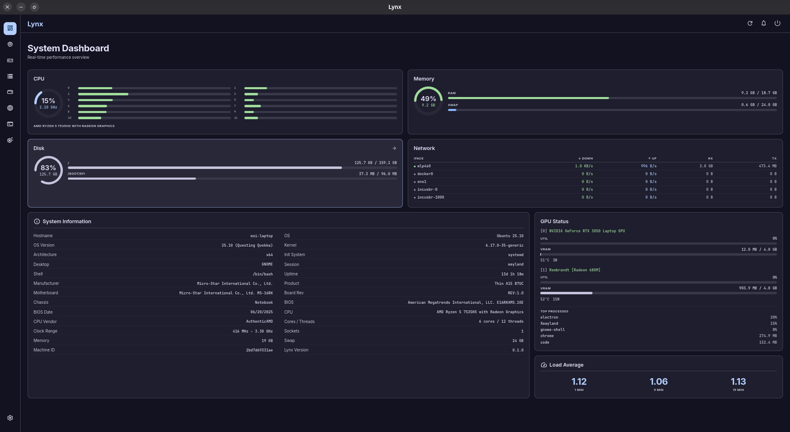
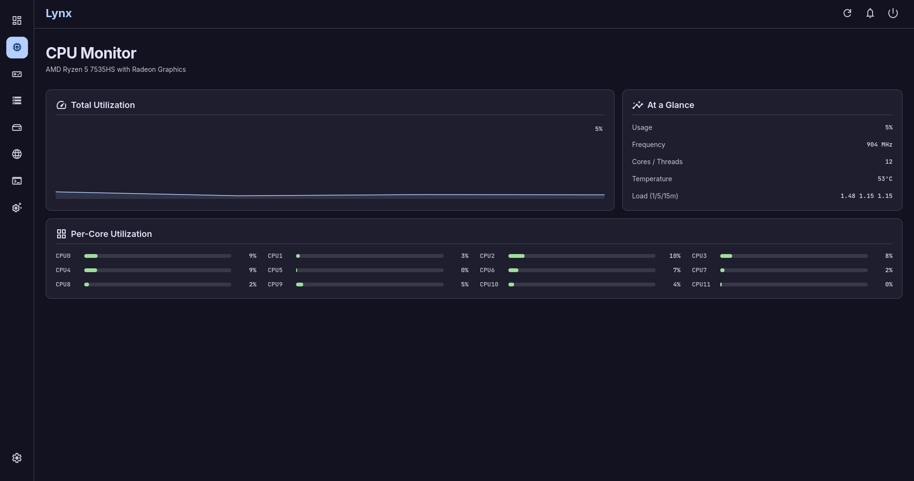
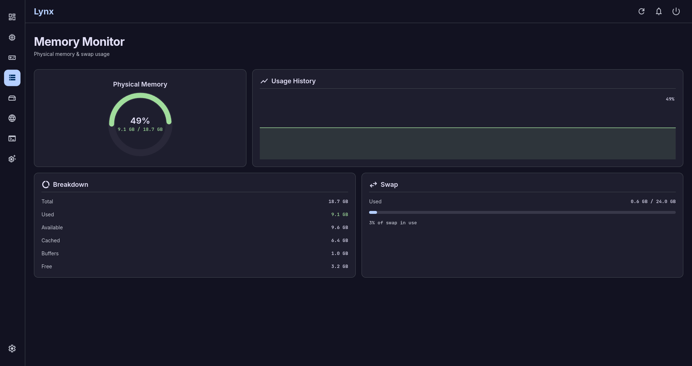
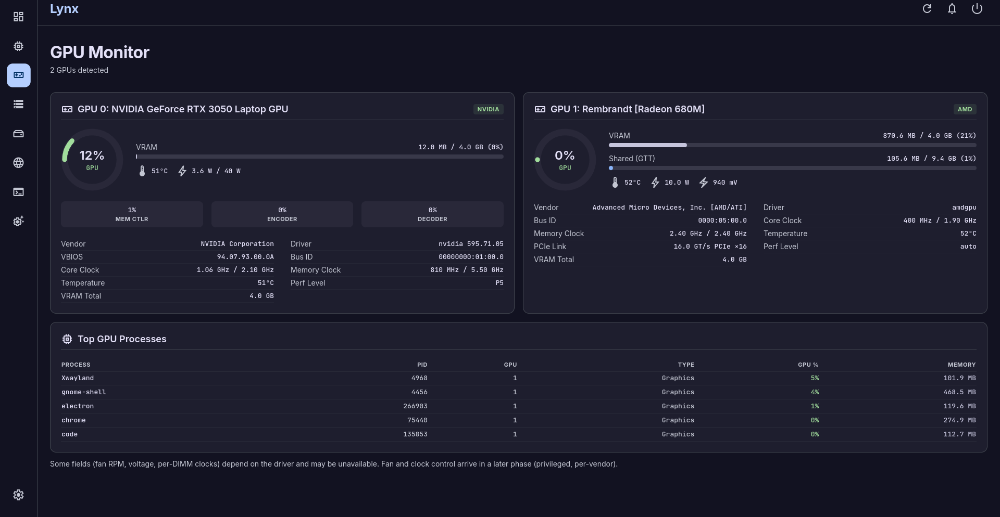
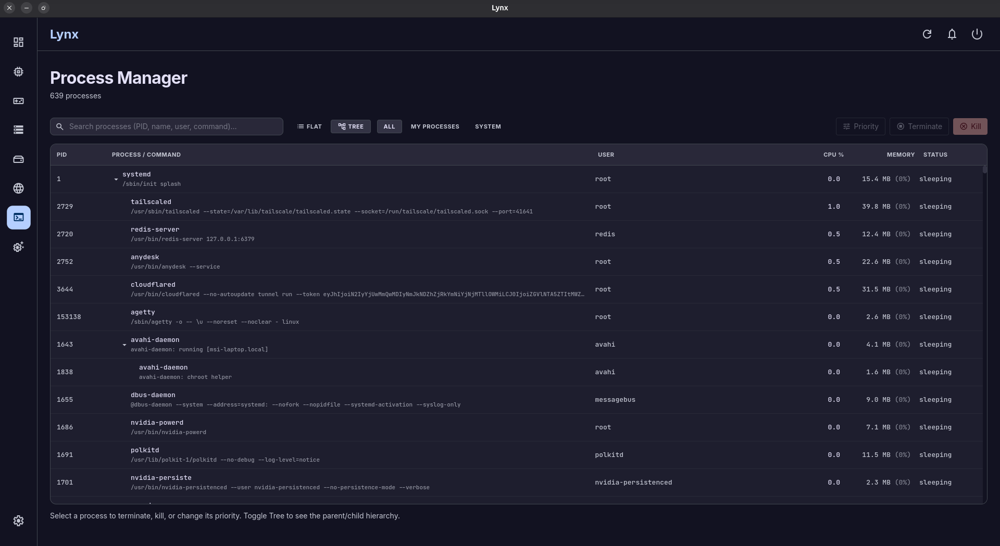
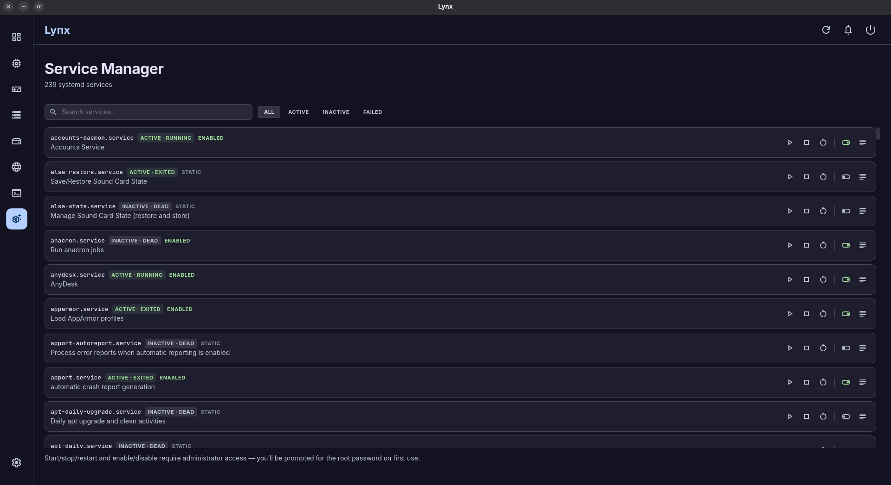
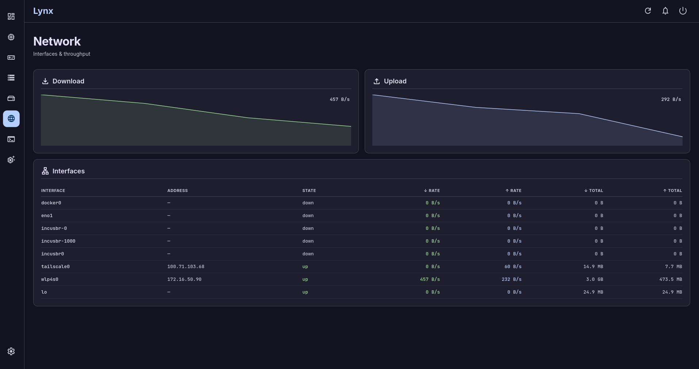

# Lynx

> A modern, all-in-one desktop application for monitoring and managing Linux systems.

Lynx replaces the patchwork of CLI tools — `htop`, `systemctl`, `journalctl`, `apt`/`pacman`, `nvidia-smi`, `smartctl` — with one consistent, real-time graphical interface. See what your machine is doing and act on it without opening a terminal.

---

## Screenshots

| Dashboard | CPU Monitor |
|-----------|-------------|
|  |  |

| Memory Monitor | GPU Monitor |
|----------------|-------------|
|  |  |

| Process Manager | Service Manager |
|-----------------|-----------------|
|  |  |

| Storage & Disk | Network |
|----------------|---------|
|  |  |

---

## Features

| Module | Capabilities |
|--------|-------------|
| **Dashboard** | At-a-glance rings (CPU/RAM/Disk/Net), system info, GPU summary, live activity |
| **CPU Monitor** | Per-core utilization, frequency & usage history, load average, temperatures |
| **GPU Monitor** | Utilization, VRAM, clocks, temperature, fan/power, per-GPU processes |
| **Memory Monitor** | RAM & swap usage, top consumers, hardware layout, cache management |
| **Storage Manager** | Drives & partitions, I/O activity, SMART health, TRIM, mount/unmount |
| **Network** | Interface stats, live throughput graphs, connections, IP addresses |
| **Process Manager** | Process list/tree, search & filter, CPU/mem%, kill, renice |
| **Service Manager** | systemd units, start/stop/restart/enable/disable, per-unit journal logs |
| **Cleaner** | Reclaim disk: package caches, thumbnails, logs, crash reports, trash |
| **Settings** | Refresh intervals, polling toggles, privilege mode, theme preferences |

---

## Tech Stack

| Layer | Technology |
|-------|-----------|
| Runtime | Electron |
| UI | React 18 + TypeScript |
| Styling | Tailwind CSS (Material 3 dark theme) |
| Build | Vite + electron-vite |
| State | Zustand |
| IPC | Electron contextBridge (typed channels, zod validation) |
| Fonts | Inter (UI), JetBrains Mono (data) |
| Icons | Material Symbols Outlined |
| Packaging | electron-builder → `.deb`, `.pacman`, AppImage |

---

## Architecture

```
Renderer (React UI)
    │  contextBridge (window.lynx)
Preload (isolated)
    │  ipcRenderer.invoke / .on
Main Process (Node)
    ├── IPC Router
    ├── Collectors  (cpu, mem, gpu, proc, disk, net)
    ├── Backend Adapters  (systemd, apt/pacman/flatpak/snap)
    ├── Privilege Manager  (polkit/pkexec → sudo-PTY fallback)
    └── Action Executors  (kill, renice, systemctl, clean…)
    │
System  (/proc, /sys, systemd, polkit, CLIs)
```

**Security:** `contextIsolation: true`, `nodeIntegration: false`, `sandbox: true`. The renderer never touches Node or system APIs directly — only through the curated `window.lynx` surface. No remote content is loaded.

**Privilege model:** actions that need root prompt for a password via an on-screen Material 3 dialog. If the prompt is cancelled, Lynx continues at user privilege, performing whatever is possible and clearly reporting what was skipped.

---

## Getting Started

### Prerequisites

- Node.js ≥ 20
- Linux (Debian/Ubuntu/Arch-based)

### Install & Run

```bash
npm install
npm run dev
```

### Build Packages

```bash
# .deb (Debian / Ubuntu / Mint)
npm run dist:deb

# .pkg.tar.zst (Arch / Manjaro)
npm run dist:arch

# AppImage (universal)
npm run dist:appimage
```

---

## Supported Distros

| Family | Examples | Package backend |
|--------|----------|-----------------|
| Debian-based | Ubuntu, Mint, Pop!_OS | `apt` / `dpkg` |
| Arch-based | Arch, Manjaro, EndeavourOS | `pacman` |

Cross-distro: **Flatpak**, **Snap** (detected automatically; hidden when not installed).

---

## License

MIT
